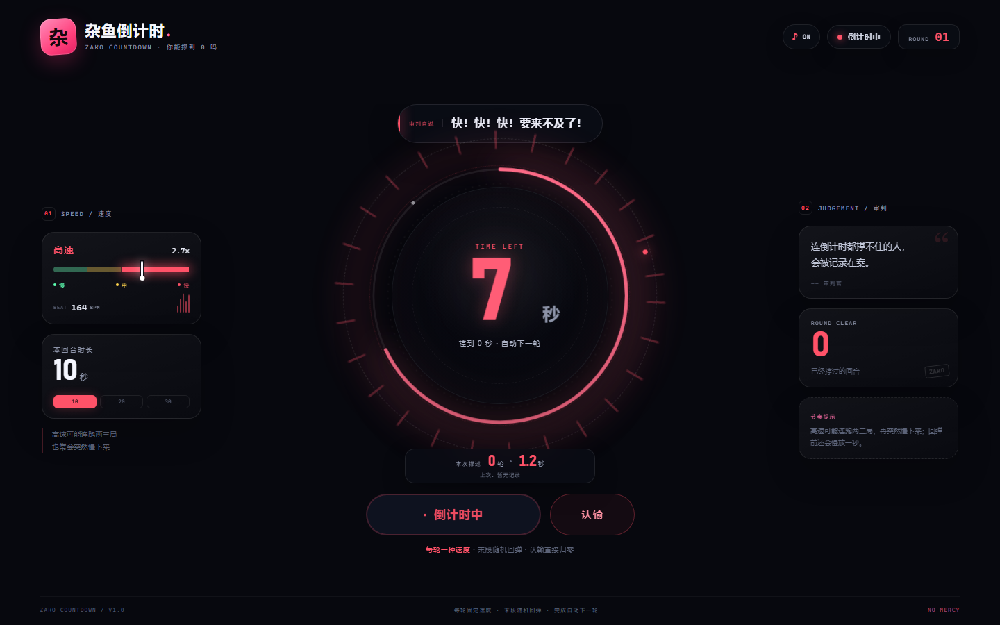

# 杂鱼倒计时 / ZAKO COUNTDOWN

一个会嘲讽你的倒计时小游戏：每轮随机锁定一种速度，数字会突然回弹，回弹前还会慢放，撑到 0 秒自动进入下一轮。

## 玩法

- 每轮从 **10 / 20 / 30 秒** 中随机选择一个时长。
- 每轮只锁定 **慢速 / 中速 / 高速** 中的一种速度，不会中途变速。
- 后期高速概率会上升，但高速可以连续出现两三局，然后突然切到慢速。
- 倒计时偶尔会在最后阶段触发回弹；回弹前的最后 1 秒会进入慢放。
- 数字每跳一下触发一次卡点鼓点，BPM 和本轮速度同步。
- 按「认输」立即归零，弹出「杂鱼杂鱼，这都坚持不住」。
- 正常撑到 0 会自动进入下一轮；认输后不会自动开始，必须按「再来一次」。
- 倒计时下方显示本局撑过的轮数、实际坚持秒数。
- 认输后会把成绩保存到浏览器 `localStorage`，下次打开仍能看到「上次」记录。

## 运行

直接双击 `index.html` 即可。

音频需要用户第一次点击「开始倒计时」后才能播放，这是浏览器的自动播放限制。

## 部署到 GitHub Pages

1. 把本目录上传到 GitHub 仓库。
2. 仓库 **Settings → Pages**。
3. Source 选择 **Deploy from a branch**，分支选 `main`，目录选 `/ (root)`。
4. 访问 `https://<用户名>.github.io/<仓库名>/`。

这是纯静态页面，不需要 Node、后端或构建步骤。

## 文件

- `index.html` — 完整游戏（HTML / CSS / 原生 JS / Web Audio）
- `preview-desktop.png` — 桌面端运行截图
- `preview-slowmo.png` — 慢放回弹截图
- `preview-surrender.png` — 认输与成绩截图
- `preview-mobile.png` — 手机端截图
- `preview-mobile-surrender.png` — 手机端认输截图

## 技术

- 原生 HTML / CSS / JavaScript
- Web Audio API 合成鼓点与音效
- CSS 动画与 SVG 环形进度
- `localStorage` 保存上次成绩
- 响应式布局，适配桌面与手机

仅供娱乐。
